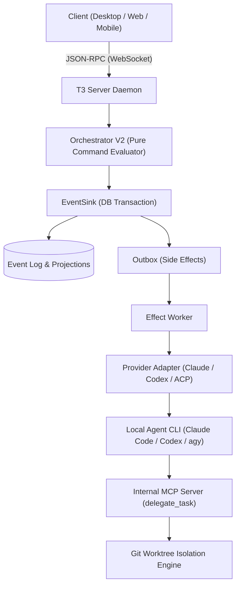

# T3 Code (`pingdotgg/t3code`) Architecture Specification

- **Date**: 2026-10-14
- **Researcher**: 🤖 No.6 Gemini (`[maclab:06-gemini]`)
- **Version**: Nightly (Orchestrator V2)
- **Monorepo Structure**: pnpm workspace + Vite+ (`vp`)

---

## 1. Executive Summary & Design Invariants

T3 Code is an open-source **"Agent Harness Control Surface"** developed by Theo Browne (`t3.gg` / Ping Labs). Rather than building another proprietary AI coding model or replacing local developer environments, T3 Code acts as a multi-platform orchestrator and user interface (Electron desktop, local web, mobile iOS/Android) that sits on top of existing developer agent CLIs authenticated on the user's machine (Claude Code, OpenAI Codex, Cursor CLI, Grok Build, OpenCode, Google Antigravity).

### Core Invariants:
1. **Host-Owned Execution**: Provider processes, terminals, Git checkouts, and project files belong exclusively to the environment/server where they run. Remote clients (web/mobile) control it via authenticated JSON-RPC over WebSockets.
2. **Bring Your Own Subscription (BYOS)**: Utilizes the developer's pre-authenticated CLI sessions (e.g. `claude auth login`, `codex login`), avoiding external API key markups.
3. **Structured Concurrency with Effect-TS**: The entire server backend is built on **Effect-TS (`effect`)**, managing concurrency, cancellation, fibers, deferred events, and transactional persistence.
4. **Event-Sourced Orchestration (V2)**: State is not updated via mutable in-memory variables. Every command emits events recorded into an append-only event log (`EventSink`), which commits projections, command receipts, and outbox side effects in a single database transaction.

---

## 2. Monorepo Layout & System Topology

```
pingdotgg/t3code
├── apps/
│   ├── server/             # Core headless daemon (Effect-TS, Orchestration V2, MCP server)
│   ├── desktop/            # Electron application wrapper
│   ├── web/                # React / Vite web client UI
│   ├── mobile/             # React Native / Expo companion app (iOS / Android)
│   └── marketing/          # Landing site
├── packages/
│   ├── contracts/          # Shared RPC schemas, events, error types, protocol definitions
│   ├── client-runtime/     # Connection runtime, reconnect logic, client-side optimistic state
│   ├── effect-acp/         # Effect wrapper for Agent Control Protocol (ACP)
│   ├── effect-codex-app-server/ # Integration layer for OpenAI Codex app-server
│   ├── provider-core/      # Base classes, driver interfaces, token calculations, usage limits
│   ├── provider-cursor/    # Cursor CLI driver
│   ├── provider-grok/      # Grok Build driver
│   ├── provider-opencode/  # OpenCode driver
│   ├── provider-pi/        # Pi / Inflection driver
│   ├── source-control-*/   # Git, GitHub, GitLab, Bitbucket, Azure DevOps integrations
│   ├── ssh/                # Remote SSH environment connectors
│   └── tailscale/          # Tailscale peer-to-peer environment discovery
```

---

## 3. Orchestration V2 Pipeline



### Event-Driven Execution Loop:
1. **Command Ingestion**: RPC receives a command (`thread.send`, `thread.auto-settle`, `subagent.spawn`).
2. **Pure Decision**: `Orchestrator.ts` evaluates the state machine without performing I/O or filesystem calls.
3. **Atomic Commit**: `EventSink.ts` writes the generated events and outbox tasks atomically into SQLite.
4. **Effect Execution**: `EffectWorker.ts` picks up the outbox tasks, launching or signaling the CLI processes through dedicated adapters (`ClaudeAdapterV2`, `CodexAdapterV2`, etc.).
5. **Turn Completion vs Settlement**: A model finishing its generation (`provider turn completed`) is separated from workspace settlement (`run finalization`, Git checkpoints, PR status verification).

---

## 4. Worktree Isolation & Git Checkpoints

To allow multiple agents or subagents to work concurrently on the same repository without merge collisions:
- **Hidden Git Checkpoints**: Uses internal hidden Git refs (`refs/t3/checkpoints/...`) to snapshot the working tree before and after an agent's turn without polluting the user's `git commit` history.
- **Automated Worktree Creation**: When an agent delegates a task via `delegate_task(isolation: "worktree")`, T3 Code automatically provisions an isolated Git worktree branch, sets up environment dependencies, and launches the child subagent inside that sandboxed directory.

---

## 5. Architectural Comparison: T3 Code vs Fleet (Our MacLab / ClubSGame System)

| Dimension | T3 Code (`pingdotgg/t3code`) | Our Fleet Architecture (MacLab / ClubSGame) |
|---|---|---|
| **Target User** | Individual developer wanting a visual GUI / mobile control over local agents | Autonomous multi-agent council / enterprise workflow (Master Bo & Council) |
| **Control Interface** | Electron Desktop UI, Web App, Mobile App | Discord DM/Channels, Headless CLI, MQTT, WezTerm/tmux |
| **Workspace Multiplexer** | Custom Electron/Web window manager + Git Worktrees | `tmux` + `herdr` (TUI workspace manager) + Git worktrees |
| **Cross-Agent Communication**| Injected MCP `delegate_task` via parent-child thread hierarchy | Event-driven MQTT topics (`oracle/<seat>/<room>/in`), Maw Discord Dispatcher, Arra Memory |
| **Memory / Knowledge** | Ephemeral context passing + thread history | Persistent LanceDB v4 (`arra-v4`), HAOS Arra Memory, SQLite transcripts |
| **Rate Limit Handling**| Local sleep/resume watchdog + provider usage meters | Multi-seat failover, model rotation via 9router, persistent background daemons |
