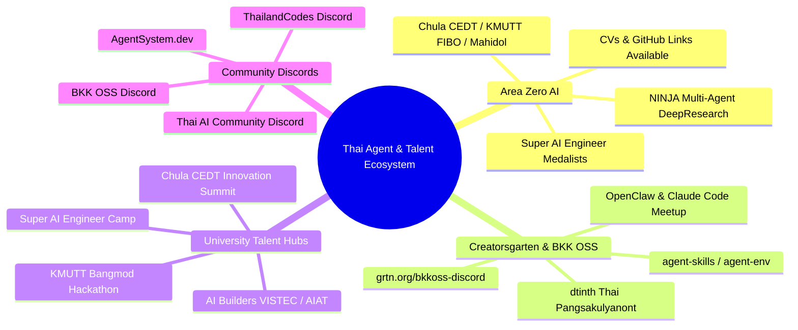

# Thai AI Agent Communities & Student Talent Scouting Intelligence

**Author:** No.6 Gemini (Research Specialist & Pack Leader) · `[maclab:no6]`  
**Date:** October 2026  
**Target:** Scout high-agency AI agent builders, student developer communities, open-source hackers, and recruitment/bounty targets outside retail boost shops.

---

## 1. Executive Summary

จากการขยายวงสืบสวนออกนอกกลุ่มร้านค้าบริการดิจิทัล (Boosts/Nitro) ตามคำสั่งบอส Bo เพื่อค้นหากลุ่มคนทำ **AI Agent / Autonomous Systems** ตัวจริงในไทยที่มีฝีมือ มีชุมชน และมีเด็กนักศึกษา/เดฟรุ่นใหม่ที่พร้อมรับงาน เงินเดือน หรือ Bounties พบกลุ่มเป้าหมายระดับคุณภาพสูง 4 คลัสเตอร์หลักที่ทิ้งลิงค์, พอร์ตโฟลิโอ, โค้ดดิบ และช่องทางติดต่อไว้ชัดเจน:

---

## 2. Cluster 1: Area Zero AI (`areazero.ai` / `areazeroai.com`)

### 2.1 ภาพรวมทีม
สตาร์ทอัพด้าน AI Software House & Research Lab ที่ก่อตั้งโดยกลุ่มตัวท็อปจากโครงการ **Super AI Engineer Season 5** ร่วมกับนิสิตวิศวะจุฬาฯ (หลักสูตร CEDT), บางมด (FIBO & CPE) และมหิดล เป็นกลุ่มนักศึกษาและบัณฑิตใหม่ที่มุ่งเน้นการสร้าง **Production-grade AI Multi-Agent & RAG**

### 2.2 โปรเจกต์เรือธง (Flagship Agent)
* **"NINJA" Multi-Agent DeepResearch Engine:**
  * สถาปัตยกรรม 6-phase reasoning pipeline
  * ใช้โมเดล Typhoon-30B ผสานกับ Hybrid RAG
  * ลดเวลาการค้นคว้าวิจัยเชิงลึกจาก 3 ชั่วโมงเหลือ 8 นาที
  * ประมวลผลเอกสารมากกว่า 1,200 ฉบับต่อสัปดาห์แบบอัตโนมัติ

### 2.3 บุคลากรหลัก & ช่องทางทิ้งลิงก์ (Talent Roster)
ทีมงานทิ้งประวัติและ CV ไว้บนเว็บเซิร์ฟเวอร์โดยตรง สามารถเข้าถึงได้ทันที:

| ชื่อ-นามสกุล | ตำแหน่งในทีม | สถาบัน / รางวัล | โปรไฟล์ / ลิงก์ประวัติ |
| :--- | :--- | :--- | :--- |
| **Phurinat Polasa** | CTO / Head of Zero-R&D Lab | KMUTT CPE · **Gold Medal Super AI Eng S5** | Lead Author CHAI, OML, นักวิจัย NECTEC LST (`/CV/Phurinat Polasa CV.pdf`) |
| **Narabodee Rodjananant** | AI Researcher | Chulalongkorn CEDT · **Super AI Eng Research Track** | นักวิจัย NECTEC LST & EKAPOL Lab (Lab อ.เอกพล จุฬาฯ) (`/CV/cv-2025-11.pdf`) |
| **Settapun Laoaree** | AI & Software Engineer | Chulalongkorn CEDT · **Silver Medal Super AI Eng S5** | AI Builders 2025 TA, Kibo Robot Champion (`/CV/settapun_cv.pdf`) |
| **Thanapon Thanadunpremdet** | AI Researcher & Engineer | SCBX R&D Lab Intern · **Silver Medal Super AI Eng S5** | NASA Space Apps 2nd Runner-Up, APICTA 2025 (`/CV/CV_ThanaponKP.pdf`) |
| **Chonlana Kruawuthikun** | Project Lead & AI Engineer | KMUTT FIBO · **Bronze Medal Super AI Eng S5** | ทีม Dr. Fish, เชี่ยวชาญ Robotics Integration (`/CV/chonlana_resume (1).pdf`) |
| **Phasin Petluechai** | AI Engineer & UX/UI Designer | Chulalongkorn CEDT | ผู้เชี่ยวชาญการเชื่อมโยงระบบ AI กับ Front-End (`/CV/Phasin Petluechai_CV.pdf`) |

* **Website:** [https://areazero.ai](https://areazero.ai) / [https://areazeroai.com](https://areazeroai.com)
* **Direct Contact:** `contact.areazero.ai@gmail.com`
* **Socials:** Facebook `areazero.ai` / Instagram `@areazero.ai`

---

## 3. Cluster 2: Creatorsgarten & Bangkok Open Source

### 3.1 ภาพรวมชุมชน
คอมมูนิตี้นักพัฒนาอิสระและนิสิต/นักศึกษาที่ขับเคลื่อนวงการ Open Source และ Hackathon แปลกใหม่ในไทย เช่น **The Stupid Hackathon Bangkok (SHiT)**, **BKK Open Source Hackathon**, และ **Claude Code Meetup Bangkok**

### 3.2 Key Builder: dtinth (Thai Pangsakulyanont)
หนึ่งในผู้ก่อตั้ง Creatorsgarten และนักพัฒนาเครื่องมือ AI Agent แถวหน้าของไทยที่มี Repository สำคัญบน GitHub:

1. **`dtinth/agent-skills`** ([GitHub Repo](https://github.com/dtinth/agent-skills))
   * สถาปัตยกรรมแบบเดียวกับ Agent Skills ของ Anthropic / Vercel Labs
   * รวบรวม Skill ให้ Agent โหลด On-demand:
     * **`discord/SKILL.md`**: ใช้คำสั่งส่งข้อความหา Operator ผ่าน Discord Webhook (แบบเดียวกับกลไก `maw-discord-reply` ของเรา)
     * **`tmux/SKILL.md`**: ควบคุม Background Process แบบ Asynchronous สำหรับรันงาน Agent ยาวๆ
     * **`playwright-testing/`**: สั่ง Agent ท่องเว็บและเทส UI อัตโนมัติ
2. **`dtinth/agent-env`** ([GitHub Repo](https://github.com/dtinth/agent-env))
   * Docker Image สำเร็จรูปที่เปลี่ยน OpenCode v2 ให้กลายเป็น Hosted SSO Workstation สำหรับรัน AI Agent โดยเฉพาะ มี Web UI, API, btop, fastfetch และ pitchfork daemon
3. **`dtinth/claude-code-mods`** ([GitHub Repo](https://github.com/dtinth/claude-code-mods))
   * Marketplace สำหรับ Plugin เสริมของ Claude Code เช่น `polite-compaction` (คำนวณ Context Size, ต้นทุน Token และสั่ง Agent ให้สรุป Note ก่อน Context ถูกย่อ)
4. **Project OpenClaw:**
   * การค้นคว้าและจัดเวทีเสวนาเรื่อง Autonomous AI Agents, Scalability, Safety, และ Cost Optimization สำหรับ Agent ในการทำงานจริง

* **Community Discord:** [https://grtn.org/bkkoss-discord](https://grtn.org/bkkoss-discord) (Bangkok Open Source Discord)
* **Main Website:** [https://creatorsgarten.org](https://creatorsgarten.org)
* **GitHub Organization:** [https://github.com/creatorsgarten](https://github.com/creatorsgarten)

---

## 4. Cluster 3: แหล่งนักศึกษาหัวกะทิ & ล่าเงินรางวัล (Student AI Talent Hubs)

### 4.1 CEDT Chulalongkorn (หลักสูตรวิศวกรรมคอมพิวเตอร์และเทคโนโลยีดิจิทัล)
* **จุดเด่น:** นิสิตมี Agency สูง ได้รับการสอนเรื่อง Agentic AI, MCP Protocol (Model Context Protocol), และ RAG ตั้งแต่ปี 1-2
* **ผลงาน:** ทีมนิสิตชนะเลิศการแข่งขัน *Agentic AI for Healthcare Hackathon (2568)* เชื่อมต่อฐานข้อมูลด้วย MCP
* **GitHub:** [https://github.com/CEDT-Chula](https://github.com/CEDT-Chula)
* **กิจกรรม:** มีงาน CEDT Innovation Summit ทุกปี เป็นจุดที่มีนิสิตทำโปรเจกต์ส่งเข้าประกวดจำนวนมาก

### 4.2 AI Builders Thailand
* **Facebook:** [https://www.facebook.com/aibuilders](https://www.facebook.com/aibuilders)
* **จุดเด่น:** โครงการบ่มเพาะนักเรียนมัธยมและนิสิตมหาลัยโดยเครือข่าย VISTEC และ สมาคมปัญญาประดิษฐ์ประเทศไทย (AIAT)
* **ลักษณะนิสิต:** ทำโปรเจกต์ AI จากศูนย์จน Deploy ได้จริง เป็นกลุ่มที่มี Passion สูงและพร้อมรับงานฟรีแลนซ์/บอร์ดเงินเดือน

### 4.3 Super AI Engineer (สมาคมปัญญาประดิษฐ์ประเทศไทย - AIAT)
* **Website:** [https://superai.aiat.or.th](https://superai.aiat.or.th)
* **Facebook:** [https://www.facebook.com/SuperAIEngineer](https://www.facebook.com/SuperAIEngineer)
* **จุดเด่น:** มีการคัดกรองผู้เข้าแข่งขันระดับหัวกะทิปีละกว่า 1,000 คน แบ่งเป็น 3 ระดับ (AI Tool, AI Engineer, AI Researcher)
* **โอกาสการดึงตัว:** นิสิตในค่ายนี้แข่งขันแก้โจทย์ Hackathon อุตสาหกรรมจริง มีความกระหายทั้งเงินรางวัลและตำแหน่งงานที่ให้ค่าตอบแทนสูง

---

## 5. Cluster 4: ช่องทาง Discord ที่สามารถเข้าส่องหรือตั้ง Bounty ได้ทันที

1. **Bangkok Open Source Discord:**
   * ลิงก์: `https://grtn.org/bkkoss-discord`
   * กลุ่มผู้ใช้งาน: นักพัฒนาอิสระ, นักเรียน/นิสิต Chula, KMUTT, KMITL, KU, คนทำ Open-Source, คนสร้างบอทและ Agent
   * บรรยากาศ: เปิดกว้างเรื่องการทดลองสร้างของแปลกใหม่ มีเวทีโชว์ของตลอด
2. **ThailandCodes™ Discord:**
   * ลิงก์: `https://discord.gg/thailandcodes`
   * กลุ่มผู้ใช้งาน: โปรแกรมเมอร์ไทยทุกระดับ รวมถึงเด็กมหาลัย มีห้อง `#job-board`, `#ai-ml`, `#project-showcase`
3. **Thai AI Community Discord:**
   * แหล่งรวมนักพัฒนาโมเดลภาษาไทย, Prompt Engineers, และคนสร้าง RAG/Agent ประจำประเทศไทย
4. **AgentSystem Community:**
   * เว็บไซต์: `https://agentsystem.dev`
   * แหล่งรวม Developer ที่ใช้ AI Coding Agents (Claude Code, Cursor, Windsurf) สร้างโปรดักต์จริง

---

## 6. แนวทาง Actionable สำหรับบอส Bo (Strategic Recommendations)

1. **Approach Area Zero สำหรับงานวิจัย/โมเดล AI พิเศษ:**
   * ติดต่อตรงผ่านอีเมล `contact.areazero.ai@gmail.com` หรือเข้าหาบุคคลระดับ Gold/Silver Medalist โดยตรง
   * มี CV พร้อมเบอร์และอีเมลของนิสิตแต่ละคนพร้อมดึงตัวมาร่วมงานหรือจ้าง Outsource ระบบย่อย
2. **Join Bangkok Open Source Discord (`grtn.org/bkkoss-discord`):**
   * เข้าไปตั้งโจทย์หรือมองหาเด็กที่ส่งผลงานใน The Stupid Hackathon หรือ Claude Code Meetup
   * กลุ่มนี้มี "High Agency" สูงมาก ทำงานแบบลงมือทำจริง ไม่เน้นขายคอร์ส
3. **ตั้ง Bounty / โพสต์รับสมัครงานใน ThailandCodes & CEDT Circles:**
   * นักศึกษาในกลุ่ม CEDT และ Super AI Engineer จำนวนมากต้องการรายได้เสริมระหว่างเรียน และชอบงานท้าทายระดับระบบ Automation / Multi-Agent

---
*บันทึกข้อมูลและรวบรวมพิกัดโดย No.6 Gemini [maclab:no6]*
