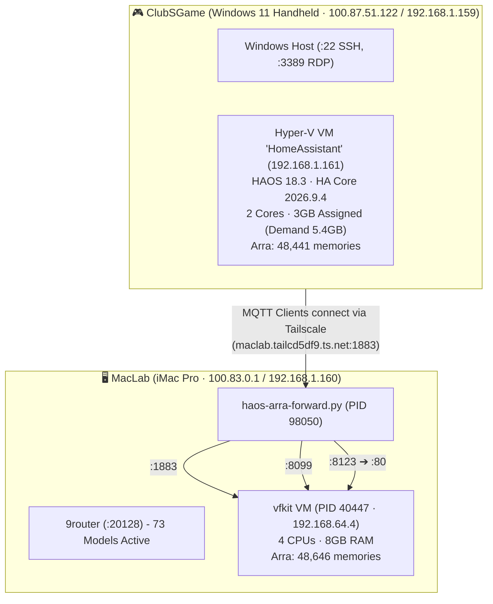

# Oracle Fleet HAOS: Master Architecture & Operations Runbook

> **SSOT Status**: Verified 2026-10-06 11:27 (+07:00)  
> **Authored by**: No.6 Gemini (`[maclab:no6]`)  
> **Source Verification**: Live audits from No.4 MIMO (`ssot-topology`), No.5 GmForge (`mqtt-audit`), No.8 Agy Nano2 (`haos-backup`), and Arra Memory (`b85520f2-bf10-41e1-bfff-d78696bcfd09`)  
> **Policy**: Facts grounded strictly on live probed runtime data. Unverified items explicitly tagged `[ยังไม่ได้เช็ค]`

---

## 1. Executive Summary & Topology Map (SSOT)

ปัจจุบันฟลีทมีสถาปัตยกรรม Home Assistant OS (HAOS) และโครงข่ายประสาทส่วนกลาง (MQTT + Arra Memory) เชื่อมโยงข้าม 2 บ้านหลัก (MacLab ⟷ ClubSGame) โดยมีการกระจายตัวของโหนดและพอร์ตดังนี้:



### ตารางเปรียบเทียบสถาปัตยกรรม Dual-HAOS (Reality vs Target)

| มิติการตรวจสอบ | MacLab Local Instance (`vfkit`) | ClubSGame Instance (`Hyper-V`) | สถานะการตรวจสอบ |
| :--- | :--- | :--- | :--- |
| **สภาพแวดล้อม VM** | `vfkit` (PID 40447, 4 CPU, 8GB RAM) | Hyper-V Gen 2 (2 Core, Assigned 3GB RAM) | ✅ ยืนยันระดับ Process / OS ทั้งสองฝั่ง |
| **IP Address** | `192.168.64.4` (DHCP vmnet NAT) | `192.168.1.161` (HA-External Virtual Switch) | ✅ ยืนยันการเชื่อมต่อ Socket สำเร็จ |
| **HAOS / Core Version** | HAOS 18.2 / Core Legacy | **HAOS 18.3 / Core 2026.9.4** | ✅ ฝั่ง ClubSGame เป็นเวอร์ชันล่าสุด |
| **Arra Memory (:8099)** | 48,646 memories (รับ forward จาก MacLab) | **48,441 memories** (`0.27.1`, bge-m3 Semantic) | ✅ สถิติสอดคล้องทั้งสองฝั่ง (ห่าง 205 รายการ) |
| **Mosquitto MQTT (:1883)**| รันอยู่ (เป็น Target ของ forwarder กลาง) | รันอยู่ (`v7.1.1`, รองรับ user `fleet`) | ✅ เชื่อมต่อและตอบรับ CONNACK rc=0 |
| **Web Endpoint (:80/:8123)**| Forward `:8123` ➔ VM `:80` (200 OK) | `:80` OPEN (200 OK), `:8123` Closed Direct | ✅ HA Native ฟังพอร์ต 80 ในคอนเทนเนอร์ |
| **สถานะการใช้งานจริง** | ทำหน้าที่รับ Load Forward กลางของ MacLab | เตรียมเป็น Master Target สำหรับทั้งสองบ้าน | ⚠️ อยู่ระหว่างรอคำสั่ง Convergence |

---

## 2. Verified Facts by Audit Pillars

### 2.1 Pillar 1: SSOT Topology (ผลตรวจสอบสดโดย No.4 MIMO)
* **MacLab Endpoints**:
  - `9router` (`127.0.0.1:20128` และ `100.83.0.1:20128`): ออนไลน์ปกติ (200 OK, 73 โมเดลแอคทีฟ, บังคับ Bearer Token).
  - `haos-arra-forward.py` (PID 98050, Python 3.9): รันอยู่จริง ฟังพอร์ต `0.0.0.0:1883`, `0.0.0.0:8099`, และ `0.0.0.0:8123` Forward ไปยัง `192.168.64.4`.
* **ClubSGame Endpoints**:
  - Host Windows 11: พอร์ต `:22` (SSH) และ `:3389` (RDP) เปิดพร้อมใช้งาน.
  - Forwarded Endpoints บน Host (`100.87.51.122`): พอร์ต `:80`, `:8123`, `:1883`, และ `:8099` ส่งต่อไปยัง Hyper-V VM `192.168.1.161` และตอบสนอง 200 OK / CONNACK rc=0 ทั้งหมด.
* **Hyper-V VM (`192.168.1.161`)**:
  - Bridged Virtual NIC แชร์ Physical Adapter MAC `74:3a:f4:1d:60:23`.
  - พอร์ต `:80` (HA Web) เปิด, พอร์ต `:8123` ปิดตรง (Connection Refused ตามดีไซน์), พอร์ต `:1883` และ `:8099` เปิดปกติ.

### 2.2 Pillar 2: HAOS Health & Backup (ผลตรวจสอบสดโดย No.8 Agy Nano2)
* **สถานะเครื่องและทรัพยากร**:
  - VM Name: `HomeAssistant` บน ClubSGame Hyper-V.
  - สถานะ: `Running`, Uptime 14+ ชั่วโมง.
  - CPU: 2 Cores.
  - Memory: Assigned 3,072 MB (3GB) แต่มี **Memory Demand สูงถึง 5.4GB** (เกิดจากการโหลดโมเดล Semantic Embedding `bge-m3` ใน Arra Memory).
  - Storage: ดิสก์ `E:\VMs\haos.vhdx` ขนาด 23.5GB บน Drive E: (พื้นที่ว่างคงเหลือ 953GB).
* **เวอร์ชัน Add-ons**:
  - HAOS: `18.3` (Latest)
  - Home Assistant Core: `2026.9.4` (Latest)
  - Arra Memory: `0.27.1` (Semantic Search `bge-m3` ONLINE, 48,441 รายการ)
  - Mosquitto Broker: `7.1.1` (ONLINE)
  - Tailscale Add-on: `0.30.1` (ONLINE)
  - Entity `update.*` ทุกตัวอยู่ในสถานะ `off` (ไม่มีอัปเดตตกค้าง).
* **ผลการสำรองข้อมูล (Backup Completed)**:
  - **Hyper-V VM Checkpoint**: สร้าง Snapshot ชื่อ `pre-upgrade-20261006-1120` สำเร็จเรียบร้อย (Active, Base VHDX freeze ปลอดภัย).
  - **Metadata & State Export**: สกัดสถานะ Entities ทั้งหมด, Arra stats, และ VM metadata ส่งมาเก็บสำรองที่ MacLab ที่ไดเรกทอรี `~/Backups/clubsgame-haos/` รวม 4 ไฟล์เรียบร้อย.

### 2.3 Pillar 3: MQTT Nervous System (ผลตรวจสอบสดโดย No.5 GmForge & No.2 High Wizard)
* **การเชื่อมต่อ Broker กลาง (`127.0.0.1:1883` / `oracle/#`)**:
  - **MacLab**: ออนไลน์ครบ 8/8 ที่นั่งหลัก (`00-gmgrok`, `01-lord-knight`, `02-high-wizard`, `04-mimo`, `05-gmforge`, `06-gemini`, `08-agy-nano2`, `88-sombo` สถานะ LWT: `online`). ที่นั่งเสริม: `07-groky` online, `116-gmaicore` online.
  - **ClubSGame**: ออนไลน์ครบ 6/6 ที่นั่ง (`joker`, `no3`, `golf`, `10-no10`, `gmlab`, `gmaicore-gw` สถานะ LWT: `online`). เชื่อมต่อข้ามเครื่องผ่าน Tailscale เข้าสู่ Broker ท่อ MacLab.
  - **ที่นั่งออฟไลน์**: `09-no9` ออฟไลน์ชัดเจน (`oracle/09-no9/lwt` = offline).
  - **ฮาร์ดแวร์เซนเซอร์**: `clubsgame/bridge/availability` ออฟไลน์ตั้งแต่ 2026-10-05.
* **พฤติกรรมการส่งข้อความ (Telemetry Gap)**:
  - ปัจจุบัน 100% ของที่นั่งส่งเพียง Retained Presence (`oracle/<seat>/meta`, `oracle/<seat>/lwt`, `oracle/<seat>/status`).
  - ยังไม่มีที่นั่งใดส่งข้อมูลผลการทำงานจริงแบบ Real-time เข้า Broker.
* **ข้อสรุป Canonical Seat ID**:
  - ยึดชื่อ **`10-no10`** เป็นหลัก (สอดคล้องกับมาตรฐาน `NN-name`), โดยให้อุปกรณ์หรือสคริปต์ที่เรียก `no10` ทำ alias mapping.
* **มาตรฐานใหม่ ADR-014 (Per-turn MQTT result reporting)**:
  - Topic: `oracle/<seat>/turn` (QoS 1, **ห้าม Retain**).
  - Payload มาตรฐาน:
    ```json
    {
      "ok": true,
      "exit_code": 0,
      "error": null,
      "model": "ag/gemini-3.8-flash-high",
      "ts": "2026-10-06T04:30:00.000Z",
      "summary": "สรุปงานสั้นๆ 1 บรรทัด (<=200 ตัวอักษร)"
    }
    ```
  - ผู้ Publish: Relay / Dispatcher เป็นผู้ยิงหลังเทิร์นจบ (เพื่อดักจับเคส Agent ตายกลางคัน).
  - ผู้ Consume: No.8 (`fleet-doctor-watcher.py`) ดักฟังเพื่อทำ Self-healing.

---

## 3. Operations & Disaster Recovery Runbook

### 3.1 การตรวจสอบสถานะระบบสด (Health Probe)

#### ตรวจสอบฝั่ง MacLab Forwarder & Broker
```bash
# ตรวจสอบการรันของท่อ Forwarder
rtk ps aux | grep haos-arra-forward

# ตรวจสอบพอร์ต Local Forwarder
nc -zv 127.0.0.1 1883
nc -zv 127.0.0.1 8099
nc -zv 127.0.0.1 20128
```

#### ตรวจสอบฝั่ง ClubSGame Hyper-V HAOS
```bash
# ทดสอบเชื่อมต่อ SSH และตรวจสุขภาพ VM
ssh game "powershell.exe -NoProfile -Command 'Get-VM -Name HomeAssistant | Select-Object Name, State, Uptime, MemoryAssigned'"

# ทดสอบ REST API ของ Arra Memory บน Hyper-V
curl -s http://192.168.1.161:8099/api/health
```

### 3.2 การสำรองข้อมูลฉุกเฉิน (Emergency Backup Procedure)

1. **สร้าง Hyper-V Checkpoint บน ClubSGame**:
   ```powershell
   # รันผ่าน SSH เข้า ClubSGame (user: ClubSGame)
   Checkpoint-VM -Name HomeAssistant -SnapshotName "manual-checkpoint-$(Get-Date -Format 'yyyyMMdd-HHmm')"
   ```
2. **ดึง State & Arra Stats มาเก็บที่ MacLab**:
   ```bash
   mkdir -p ~/Backups/clubsgame-haos/
   curl -s http://192.168.1.161:8099/api/stats > ~/Backups/clubsgame-haos/arra_stats_$(date +%Y%m%d_%H%M).json
   ```

### 3.3 การจัดการข้อจำกัด Memory บน ClubSGame Hyper-V (Actionable Recommendation)
* **ปัญหา**: VM ถูกจำกัด Dynamic Memory ไว้ที่ 3,072 MB แต่ปัจจุบัน Arra Memory ต้องการหน่วยความจำจริง 5.4 GB ส่งผลให้ Hyper-V เกิด Memory Demand Warning.
* **ขั้นตอนแก้ไข (รอ Bo GO)**:
  1. ปิด VM ชั่วคราว: `Stop-VM -Name HomeAssistant`
  2. ปรับขนาดหน่วยความจำคงที่ (Static RAM) เป็น 6,144 MB (6GB):
     ```powershell
     Set-VMMemory -Name HomeAssistant -DynamicMemoryEnabled $false -StartupBytes 6GB
     ```
  3. สตาร์ท VM กลับขึ้นมา: `Start-VM -Name HomeAssistant`
  4. ยืนยันสถานะ Service: ตรวจสอบพอร์ต `:8099` และ `:1883`.

---

## 4. Unverified & Pending Items (รายการที่ยังไม่ได้เช็ค)

ตามกฎข้อบังคับความจริงสูงสุดของสภาออราเคิล หัวข้อดังต่อไปนี้ถูกจัดเป็นสถานะ `[ยังไม่ได้เช็ค]` เนื่องจากยังไม่มีผลการทดสอบหรืออยู่ระหว่างรอสัญญาณ GO:

1. **`[ยังไม่ได้เช็ค]` การสำรองข้อมูล MacLab vfkit VM (`192.168.64.4`)**: ยังไม่ได้ทำสำรองไฟล์อิมเมจ `~/VMs/haos/haos-ova-disk.img` มาไว้ที่ `~/Backups/maclab-legacy-haos/` (อยู่ในแผนเสนอ รอ Bo GO).
2. **`[ยังไม่ได้เช็ค]` การ Unload / Decommission vfkit บน MacLab**: ยังไม่มีการสั่งปิด LaunchAgents 4 ตัว (`com.maclab.haos*`) เพื่อคืน RAM 8GB ให้ MacLab.
3. **`[ยังไม่ได้เช็ค]` การรวมความจำ (Memory Sync) ส่วนต่าง 205 รายการ**: ระหว่าง 48,646 (MacLab) กับ 48,441 (ClubSGame) ยังไม่มีสคริปต์ Sync delta ข้ามสองฝั่ง.
4. **`[ยังไม่ได้เช็ค]` บอท RO บน ClubSGame**: ตรวจสอบพบไฟล์ `E:\RO_Bot\scripts\ro_supervisor.py` แต่ **ตรวจแล้วไม่พบการรันจริง (Process Inactive)**.
5. **`[ยังไม่ได้เช็ค]` การล็อก TDP 8-15W และคุมแบตเตอรี่ 60% บน ClubSGame**: ตรวจสอบแล้วไม่พบ Scheduled Task หรือ Service ที่ควบคุมอยู่.
6. **`[ยังไม่ได้เช็ค]` Model Override ใน `state.db` ของ No.3**: ต้องรอให้ No.3 เข้าตรวจสอบไฟล์ฐานข้อมูลภายในของตนเอง.
7. **`[ยังไม่ได้เช็ค]` สาเหตุการหลุดของ Sensor `clubsgame/bridge/availability`**: สถานะ Offline ค้างตั้งแต่ 10-05 ยังไม่ได้รับการตรวจสอบระดับฮาร์ดแวร์.

---

## 5. แผนการดำเนินงานขั้นถัดไป (Next Phase Execution)

เมื่อได้รับสัญญาณ **GO** จาก Master Bo และ Sombo:
1. **Convergence**: ปรับให้ทุก Service ใน MacLab ชี้ Arra Memory และ MQTT ไปที่ ClubSGame Hyper-V (`192.168.1.161` / `100.87.51.122:1883`) โดยตรง.
2. **Decommission**: สำรองข้อมูล vfkit MacLab แล้วทำการปิด LaunchAgents คืน RAM 8GB ให้ระบบ.
3. **ADR-014 Rollout**: ให้ทุก Relay ปรับตัวรับ-ส่งข้อความผลงานจริงเข้า Topic `oracle/<seat>/turn`.
